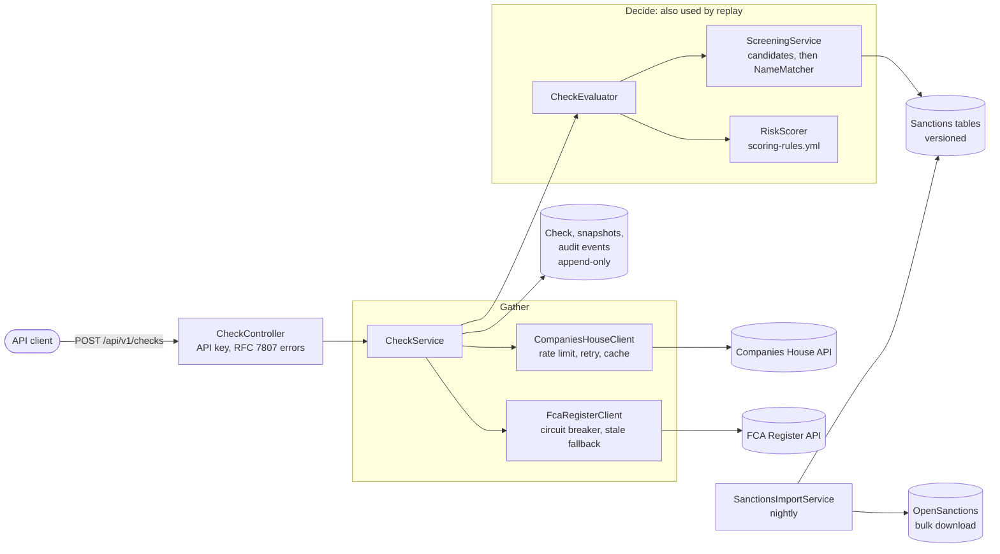

# UK KYB & Sanctions Screening Service

[](https://github.com/cypherz01/KYB_Sanctions_Screener/actions/workflows/ci.yml)

An automated Know Your Business check for UK companies, with a self-built, explainable sanctions matcher. Give it a company number and it returns `PASS`, `REVIEW` or `FAIL`, every reason behind the decision, and a record that can reproduce that decision later.

> **Disclaimer:** a portfolio project, not a compliance product. Do not use it for real onboarding decisions. Its sanctions data is licensed for **non-commercial use only**.

## What it does

Before a bank or payments firm takes on a business as a customer, it has to establish who it is dealing with: is the company real and active, who runs and owns it, is it properly regulated, and is anyone involved on a sanctions list? That process is called Know Your Business (KYB). Done by hand, it means searching several public registers and comparing names across them.

This service does that in one call. It reads the company, its directors and its owners from Companies House, looks up its status on the FCA Register, and compares every name against a local copy of the world's sanctions lists, allowing for misspellings, reordered names and other alphabets. The result is a score with the evidence for every point, and everything the decision rested on is stored, so it can be re-run and shown to come out the same.

## Architecture



What happens on `POST /api/v1/checks`:

1. **Gather.** The profile, officers, PSCs (persons with significant control) and PSC exemptions come from Companies House, through a cache. The active sanctions dataset version is pinned, so an import mid-check cannot split the check across two datasets. The FCA Register assessment comes last, and an outage there does not stop the check.
2. **Decide who is screened.** The company, every current officer and every current PSC, then any owners found by following UK corporate PSCs up the chain ([ownership look-through](#ownership-look-through)). One party holding several roles is screened once. Super-secure PSCs cannot be screened, and the result notes this.
3. **Screen** each subject against that one dataset: Postgres retrieves up to 50 candidates, then Java scores them and records the evidence.
4. **Score** with deterministic rules, whose version is recorded on the check.
5. **Store** the result, the raw response from each source and the audit events in one transaction, and return the result with `201`.

## Quick start

### See it work: no keys, about 3 minutes

Needs Docker and bash. On Windows, use Git Bash; `bash` in PowerShell is usually WSL, which fails without a Linux distribution installed.

```sh
git clone https://github.com/cypherz01/KYB_Sanctions_Screener.git
cd KYB_Sanctions_Screener
scripts/demo.sh
```

This starts the service with invented companies, an invented sanctions list and stubs in place of the real sources. Nothing about it describes any real person or company. The first run spends most of its time building the image. This is the output, from a real run:

```text
== A clean company passes
BRIGHT BAKERY LTD (07654321)
decision: PASS, score: 0
factors:

== A matching clone-firm warning on the FCA Register sends a company to a person
ACME PAYMENTS LTD (12345678)
decision: REVIEW, score: 60
factors:  FCA_CLONE_OR_UNAUTHORISED_MATCH

== A sanctioned director fails a company automatically
ACME WIDGETS LTD (01234567)
decision: FAIL, score: 0
factors:  SANCTIONS_STRONG_MATCH
automatic: a strong sanctions match fails a company whatever its score
why the match was made:
  - Names identical
  - Birth year and month match (1971-03)
  - Nationality matches (RU)
  - Name similarity 1.00 (jaro-winkler 1.00, token overlap 1.00, phonetic 1.00, alignment 1.00)

== A sanctioned owner two levels up, behind a holding company, fails a company too
NORTHGATE FOODS LTD (05550001)
decision: FAIL, score: 0
factors:  SANCTIONS_STRONG_MATCH
automatic: a strong sanctions match fails a company whatever its score
why: UPSTREAM_PSC 'Mr Ivan Petrov' strongly matches sanctioned Person 'Ivan Petrov' (similarity 1.00); effective ownership 56.25% to 100%

== The same person in Cyrillic is found too, through transliteration
Иван Петров matches Ivan Petrov: STRONG, similarity 1.0

== Any past decision can be reproduced from what it stored, with no external call
replay of the failed check: identical: true

== And everything that happened to it is on record
events: CHECK_REQUESTED SOURCES_GATHERED CHECK_COMPLETED CHECK_REPLAYED
```

Explore further at <http://localhost:8090/swagger-ui.html> with the key `demo-key`. Stop it with `docker compose -f docker-compose.demo.yml down`.

### Check a real company

You need a free [Companies House key](https://developer.company-information.service.gov.uk): create a **Live** application, as a Test key is refused by the real API. FCA credentials are optional. Without them, checks still run and report that regulatory status could not be verified.

```sh
cp .env.example .env                                  # then set COMPANIES_HOUSE_API_KEY in .env
echo "KYB_API_KEY=$(openssl rand -hex 24)" >> .env    # the key your calls to this service will send
set -a; . ./.env; set +a                              # makes KYB_API_KEY available to the commands below

docker compose up -d --build --wait
```

The first start downloads about 380 MB of sanctions data in the background. Until that is loaded, a check is refused with `503`, because "no matches" against no data would read as a clean result. Wait for it:

```sh
until curl -fs http://localhost:8080/api/v1/admin/sanctions/status -H "X-Api-Key: $KYB_API_KEY" | grep -q '"active":{'; do sleep 5; done
```

Then run a check:

```sh
curl -X POST http://localhost:8080/api/v1/checks -H "X-Api-Key: $KYB_API_KEY" \
     -H 'Content-Type: application/json' -d '{"companyNumber": "09740322"}'
```

The service and its database are published on `localhost` only, at ports 8080 and 5433. Set `KYB_PORT` or `DB_PORT` in `.env` if those are taken. To run the jar outside Docker, set `DB_URL` to `jdbc:postgresql://localhost:5433/kyb`.

## API

Every `/api/**` call needs the `X-Api-Key` header. If `KYB_API_KEY` is not set, the API refuses every call rather than running open. Errors are RFC 7807 problem details. Interactive docs are at `/swagger-ui.html`.

| Method and path | Purpose |
|---|---|
| `POST /api/v1/checks` | Run a check: `{"companyNumber": "..."}`. Returns `201` with a `Location`. |
| `GET /api/v1/checks/{id}` | The stored result, byte for byte as first returned. |
| `GET /api/v1/checks/{id}/audit` | The raw source data, versions and events behind a check. |
| `POST /api/v1/checks/{id}/replay` | Re-run a check from what it stored. |
| `POST /api/v1/screen/name` | Screen one name: `{"name": "...", "type": "PERSON", "birthDate": "1971-03", "country": "RU"}`. |
| `POST /api/v1/admin/sanctions/import` | Start a sanctions import (`202`, runs in the background). |
| `GET /api/v1/admin/sanctions/status` | The active dataset version, last import and counts. |
| `GET /actuator/health`, `/actuator/prometheus` | Health and metrics. Not behind the API key. |

## Risk scoring

Rules, points and thresholds live in [`scoring-rules.yml`](src/main/resources/scoring-rules.yml), whose version is recorded on every check.

| Factor | Points |
|---|---|
| Company not active (dissolved, liquidation, ...) | 50 |
| FCA clone or unauthorised-firm warning matches | 60 |
| Regulated SIC code but no FCA authorisation found | 25 |
| No PSCs declared (waived when Companies House records a PSC exemption, e.g. a listed company) | 15 |
| Corporate PSC registered outside the UK | 10 |
| Ownership chain ends at an owner that cannot be seen past, or reaches a limit | 15 each |
| Ownership chain loops back on itself | 25 |
| Incorporated in the last 90 days / accounts overdue | 10 each |
| FCA Register unavailable | 10 |
| High officer churn (3+ changes in 365 days) | 5 |
| Possible sanctions match | 35, plus up to 15 scaled by similarity |
| **Strong sanctions match** on the company, an officer or a direct PSC | **automatic FAIL** |
| **Strong sanctions match** above the first level | **automatic FAIL** at 50% or more, or with control. Otherwise 40, which is `REVIEW` |

A total of 40 or more gives `REVIEW`, and 80 or more gives `FAIL`. A strong match fails a company whatever the total and adds no points of its own, so a `FAIL` can show a score of 0: the `autoFail` flag on the factor says why. Each factor carries a plain-English `detail`, the source and fetch time it rests on, and for sanctions the subject, the matched entity and the matcher's evidence. Stale cached data is flagged, never hidden.

Checked on real data on 2026-11-09, with ownership look-through:

| Company | Decision | Why |
|---|---|---|
| Tesco PLC (00445790) | PASS, 0 | Listed company, so the PSC exemption explains why no PSCs are declared |
| Barclays Bank UK PLC (09740322) | PASS, 5 | Officer churn only. FCA FRN 759676 matched by Companies House number. Ownership followed to Barclays PLC, which is listed and so exempt |
| HSBC Bank PLC (00014259) | PASS, 5 | Officer churn only. Ownership followed to HSBC Holdings, also listed and exempt |
| Yorkshire Electricity Group PLC (02366995) | PASS, 15 | Ownership followed through three UK companies to Berkshire Hathaway, a US owner Companies House cannot see past |
| Lloyds Banking Group PLC (SC095000) | PASS, 30 | Officer churn, plus "regulated SIC code but not authorised": a holding company (SIC 64205) is not itself on the Register |

## Ownership look-through

A sanctioned person who owns a company through a holding company never appears on that company's own record. So a check follows UK-registered corporate PSCs up the chain, for at most 5 levels and 25 companies, and screens each company and its PSCs along the way, but not their officers. Companies House publishes ownership only as bands, so each owner's effective stake is calculated as a range: bands multiply along a path, and separate paths add up. S holding 75–100% of H, which holds 75–100% of the company, gives 56.25–100%.

The decision follows OFAC's 50% rule and the UK's "owned or controlled" test. A strong match that must hold at least 50%, or holds control, fails the company automatically. Any other strong match above the first level goes to a person, with the calculation in the evidence. A chain that cannot be followed to its end raises its own factor, so it is never read as clean. The check response includes the full `ownership` tree: who holds what, the bounds, and where each chain stopped and why.

A check made before this existed replays without look-through, with a note saying so, and the difference is reported rather than the replay refused. The planning and the reasoning are in the decision records: [review of v1 and plan](docs/adr/0001-review-of-v1-and-plan.md), [look-through scope](docs/adr/0002-look-through-scope.md), and [effective ownership and control](docs/adr/0003-effective-ownership-and-control.md).

## Audit and replay

Every check stores what it rested on, in one transaction with the result: the raw response from each source (with its fetch time and whether it was cached or stale), the sanctions dataset version, the scoring and engine versions, and a log of events.

```sh
curl http://localhost:8080/api/v1/checks/$ID/audit -H "X-Api-Key: $KYB_API_KEY"            # the full record
curl -X POST http://localhost:8080/api/v1/checks/$ID/replay -H "X-Api-Key: $KYB_API_KEY"   # re-run it
```

A replay repeats normalisation, matching and scoring from those snapshots, against the dataset version the check used, as of the date it ran. It makes no external call and reads no cache, so it gives the same answer if a director has since been delisted or a source has gone down. It runs through the same code as a live check, not a second implementation.

- **What "identical" means.** The whole result is compared field by field, not just the decision and score, and any difference is reported by path. An unchanged total could otherwise hide a changed factor.
- **Replay runs today's code and rules.** Old code is not kept, so a replay after an engine or scoring change shows the new version as a difference, along with anything that changes as a result. That is what such a replay is for: it shows what the change does to a past decision. To reproduce the original under its own rules, run the release matching its recorded `engineVersion`. Bump `kyb.checks.engine-version` whenever matching or scoring code changes, or a difference will have no version to explain it.
- **Retention.** The newest 3 sanctions dataset versions are kept. A check whose version has been pruned cannot be replayed, and asking returns `409` rather than screening against missing rows, which would look clean. Its stored result, snapshots and audit trail are kept indefinitely, and the refusal is recorded. Raise `kyb.sanctions.keep-versions` to replay further back, at about 200 MB of database per version (measured on the full dataset). Snapshots and events are never deleted, so storage grows with the number of checks, at about 33 kB of snapshots per check in the run below.
- **Append-only, enforced.** Database triggers reject `UPDATE` and `DELETE` on checks, snapshots and events. This stops mistakes, not a database administrator: `TRUNCATE` stays possible so an environment can be reset.

Checked on real data on 2026-11-08: Tesco, Barclays Bank UK, Lloyds Banking Group, HSBC Bank and Yorkshire Electricity Group, plus a repeat check served from the cache, against the full dataset. All six replayed identically, and again after restarting the application, which is when any dependence on hash ordering would show.

## FCA Register

The regulatory check uses the free [FCA Financial Services Register API](https://register.fca.org.uk/Developer/s/). Add `FCA_AUTH_EMAIL` and `FCA_AUTH_KEY` to `.env`.

- **Matching a company to a firm.** Companies House does not record the FCA reference number (FRN), so the company name is searched on the Register. Each hit is scored with the same normaliser and matcher used for sanctions. For the strongest authorised hits, the firm details are fetched: the same Companies House number is a certain match, and a different one rules the firm out. Otherwise the match rests on name (plus postcode), and its confidence and basis are reported.
- **Clone and unauthorised firms.** The API has no separate warning list. Entries with status `Unauthorised`, or names marked `(Clone)` / `(Clone of FCA authorised firm)`, are reported as warnings when their name matches.

Verified against the live Register on 2026-11-07. Barclays Bank UK PLC was matched to FRN 759676 by its Companies House number. Run that check yourself with `./mvnw -Psmoke test -Dtest=FcaRegisterSmokeTest`, with the two variables set.

## Sanctions data

Screening runs against a local copy of the [OpenSanctions](https://www.opensanctions.org/datasets/sanctions/) `sanctions` collection, downloaded as bulk FollowTheMoney JSON. The first start with an empty database imports it in the background, and it re-imports nightly at 03:30 UK time.

- **Atomic and versioned.** Each import loads under a new dataset version that screening cannot see until a single transaction makes it active. A failed or interrupted import never touches the active data.
- **Idempotent.** If the published SHA-1 matches the active version, nothing is downloaded. Downloaded files are checksum-verified.
- **What is screened.** `Person`, `Company`, `Organization` and `LegalEntity` entities tagged `sanction` or `sanction.linked`, with their names, aliases and previous names (not FtM "weak" aliases), birth dates, nationalities, countries, source lists and programmes. Relatives without a sanction, counter-sanctions, debarments and export-control-only entries are left out.

## Name matching

Each match carries a similarity (0 to 1), a band (`STRONG` ≥ 0.90, `POSSIBLE` ≥ 0.80; anything lower is discarded), the source lists and programmes, and an `evidence` list explaining the score, for example `Phonetic match: 'mohammed' ~ 'muhammad'` or `Birth year matches (1971)`.

1. **Normalise** both sides identically. ICU transliterates any script to Latin (Russian uses BGN/PCGN, as sanctions lists do, so `Жуков` becomes `zhukov`) and strips diacritics. The name is then lower-cased, `&` becomes `and`, and punctuation is removed. Titles are dropped from people and legal forms from organisations (`Ltd`, `LLC`, a leading `OOO`, ...). Each token gets a Double Metaphone key.
2. **Retrieve** up to 50 candidates in Postgres: trigram similarity (`pg_trgm`, GIN index) unioned with exact phonetic-key matches, restricted to comparable entity types. A person is never compared with a company.
3. **Score** each candidate in Java. Four weighted components are combined: Jaro-Winkler on aligned, token-sorted names; exact token overlap; phonetic agreement; and per-token fuzzy alignment. A small penalty applies for unmatched extra tokens. Birth date and nationality then adjust the score: a birth year more than one year apart costs 0.25, which is what separates two different John Smiths. A match that rests on an initial or a single token is capped below `STRONG`. A one-word listed person name (an alias such as "Adam") is never retained against a subject with a full name. Organisations are exempt, because one distinctive word can name a company.

All lists, weights and thresholds live in `application.yml`.

## Design decisions and trade-offs

**Bulk sanctions data and a local matcher, not a hosted API.** The hosted OpenSanctions API's free keys exclude hobby projects, while the bulk data is free for non-commercial use. It is also the more interesting system: owning the data means owning the matching, so every score can be explained and a past decision re-run against the exact data it used. The cost is storage, a nightly import, and being a day behind at worst, where a commercial screening service would be nearer real time.

**Rate limiting and caching for Companies House.** The API allows 600 requests per 5 minutes, and a 429 lasts for the rest of that window. So a client-side rate limit sits below it, at 550, to avoid ever being refused. A retry with jittered backoff handles what still goes wrong. Responses are cached for 24 hours in Caffeine and Postgres, so they survive a restart and repeat checks are fast. An expired entry is kept, so an outage can serve it, flagged stale, rather than fail the check. The cost is that a check can be up to a day behind the register, and the result shows the fetch time so that is visible.

**Graceful degradation for the FCA Register.** The API is free with no SLA, so it is treated as something that will go down, and the service is built to degrade rather than fail. A circuit breaker stops calls to a failing Register, and responses are cached for 7 days. During an outage, expired results are served flagged `STALE`. If nothing is cached, the check still completes, with a 10-point `FCA_UNAVAILABLE` factor and the "not authorised" rule standing down, because an outage is not evidence of anything. Companies House is different: without the company itself there is nothing to check, so that returns `503`.

**Rule-based, explainable scoring, not ML.** A compliance decision has to be justified to a person, possibly years later. Fixed rules with versioned weights give a reason for every point and the same answer every time. There is also no labelled data here to train on. The cost is that rules only catch what someone thought of, and the weights are judgement rather than fitted.

**Matching thresholds: false positives against false negatives.** A false positive costs an analyst's time, while a false negative can mean dealing with a sanctioned party, so the matcher leans towards recall. Only `STRONG` fails a company automatically, and `POSSIBLE` sends it to a person, which is how a generous recall bar stays affordable. The table under [Matching accuracy](#matching-accuracy) shows the trade directly. Birth date and nationality do much of the separating, as a common name alone proves little.

**Reproducibility and audit.** Replay runs through the same code as a live check, from stored raw responses, and compares the entire result. Snapshots are stored as `JSON` rather than `JSONB`, which would re-sort keys, and the clock ticks in microseconds to match what Postgres stores, because either could otherwise make a replay differ for no real reason. Audit tables are append-only, enforced by the database, and a replay that cannot be honest is refused rather than attempted. See [Audit and replay](#audit-and-replay).

## Matching accuracy

`src/test/resources/matching/name-pairs.psv` holds 59 labelled pairs covering word order, diacritics, transliteration, missing middle names, initials, typos, common names disambiguated by birth date, legal suffixes, `&`/`and`, near-misses that share a token, and one-word aliases. `MatchingFixturesTest` regenerates this table in `target/matching-accuracy.md`. Five "weak at most" pairs are excluded from the counts.

| Threshold | Precision | Recall | TP | FP | FN |
|---|---|---|---|---|---|
| 0.70 | 0.909 | 1.000 | 40 | 4 | 0 |
| 0.75 | 0.909 | 1.000 | 40 | 4 | 0 |
| **0.80 (POSSIBLE)** | **1.000** | **1.000** | 40 | 0 | 0 |
| 0.85 | 1.000 | 0.975 | 39 | 0 | 1 |
| 0.90 | 1.000 | 0.875 | 35 | 0 | 5 |
| 0.95 | 1.000 | 0.625 | 25 | 0 | 15 |

Lowering the threshold to 0.75 lets near-misses through. Raising it to 0.90 misses real variants such as typos and romanisations. The set is small and was written by hand, so these figures show the matcher behaves as designed. They are not a benchmark of real-world accuracy.

The set grew from real data. On the full dataset, "John Smith" first came out STRONG against "John B. Pridmore-Smith", which in a KYB check would automatically fail every John Smith. That pair and a similar one are now fixtures, and the extra-token penalty was raised to keep them below STRONG. Later, the first real check on Barclays Bank UK sent it to REVIEW, because its director Adam Banks had come out POSSIBLE (0.84) against a Taliban-listed person whose entry includes the bare alias "Adam". One-word person aliases are now discarded, and that case is a fixture.

## Performance

Measured against the full dataset (52,019 entities, about 268,500 names) with Postgres 16 in Docker on a desktop:

| What | Result |
|---|---|
| Single-name screen (`ScreeningPerformanceSmokeTest`, 90 screens, warm cache; target under 100 ms) | p50 23.9 ms, p95 45.5 ms, max 305 ms |
| Evaluating a check with no external calls (a replay, 6 to 16 subjects; target under 1 s) | 100 to 300 ms |
| Full check with the source caches empty (real Companies House and FCA) | about 1.5 to 2 s |
| Sanctions import, including download | about 30 to 70 s |
| Keyless demo from a cold build | about 3 minutes |

A replay measures the target well, because it does everything a check does except the external calls. These are single runs on one machine, not a load test. To repeat the import and screening measurements (these download the whole file):

```sh
OPENSANCTIONS_SMOKE=true ./mvnw -Psmoke test -Dtest=SanctionsImportSmokeTest
OPENSANCTIONS_SMOKE=true ./mvnw -Psmoke test -Dtest=ScreeningPerformanceSmokeTest
```

## Tests

```sh
./mvnw verify    # needs JDK 21 and a running Docker daemon for Testcontainers
```

No test calls a real external API; WireMock stands in for them. Each milestone is a pull request with two commits: the failing tests, then the implementation that makes them pass. CI runs the format check, all tests, a coverage gate of 80% on `matching` and `scoring`, the image build and the keyless demo. Real-API smoke tests are separate:

```sh
COMPANIES_HOUSE_API_KEY=your-key ./mvnw -Psmoke test
```

## Known limitations

- **UK only**, and no adverse-media screening or individual identity verification.
- **Ownership stops at the UK border**, and rests on what was declared to Companies House. A foreign owner raises a factor, but nobody behind it is seen, and a false declaration cannot be detected. A parent renamed since it was last declared can show as opaque, because its name must match the register before it is followed.
- **FCA matching is inherently ambiguous** where a firm has no Companies House number on the Register, since it then rests on name and postcode. The result reports its basis and confidence.
- **Only the first page of FCA search results** (20 firms) is considered.
- **Authorisation is checked, permissions are not.** A firm being authorised is the signal; whether it is authorised for the company's actual activity is not compared.
- **A holding company can be flagged as unauthorised.** Lloyds Banking Group picks up 25 points because SIC 64205 counts as regulated, though its subsidiaries are the firms on the Register.
- **Clone detection depends on the Register's naming conventions.**
- **The accuracy figures come from a small hand-written fixture set**, so they are not a real-world benchmark.
- **Replay trusts the stored data**, since nothing signs it, and runs today's code.
- **A check that fails part-way** (say, an unknown company) leaves only a log line, not an audit record.
- **One shared API key**, with no users or tenants, and synchronous checks only.

## Data sources and licences

The code is under the [MIT License](LICENSE). That covers this repository's code only, not the data it fetches, which keeps its own terms:

- **[OpenSanctions](https://www.opensanctions.org)**: sanctions data, licensed [CC BY-NC 4.0](https://creativecommons.org/licenses/by-nc/4.0/). Attribution is required and **commercial use is not permitted** without a separate licence. API responses carry this attribution in their `sources` field. This is what makes the whole project non-commercial.
- **Companies House**: its public data is [available free of charge, including through the API](https://www.gov.uk/guidance/search-the-companies-house-register). The developer pages carry a Crown copyright notice and name no licence, and no statement was found placing the API data under the Open Government Licence, so this project does not claim that it is. A Companies House [forum reply](https://forum.companieshouse.gov.uk/t/is-data-provided-under-the-ocs/4513) says it sets no rules on how the register's information is used, and that users remain responsible for data protection and copyright law. Officers' names and partial birth dates are personal data, even though they are public.
- **FCA Financial Services Register**: the [API is currently free, with no SLA or uptime guarantee](https://www.fca.org.uk/firms/financial-services-register). The developer portal's introduction covers access, authentication and the rate limit (50 requests per 10 seconds, with a 1-minute block on a breach), and no API-specific terms on reuse or attribution could be found there. The FCA's [website legal terms](https://www.fca.org.uk/legal) restrict reproducing and re-using its content without permission, and its [register extract handbook](https://www.fca.org.uk/publication/documents/register-extract-handbook.pdf) says the API was not designed for bulk querying. This project makes a handful of lookups per check and republishes nothing. Finding no specific terms does not mean reuse is unrestricted, so anyone building on it should ask the FCA first.

These notes were checked on 2026-11-08. They are one developer's reading, not legal advice.
